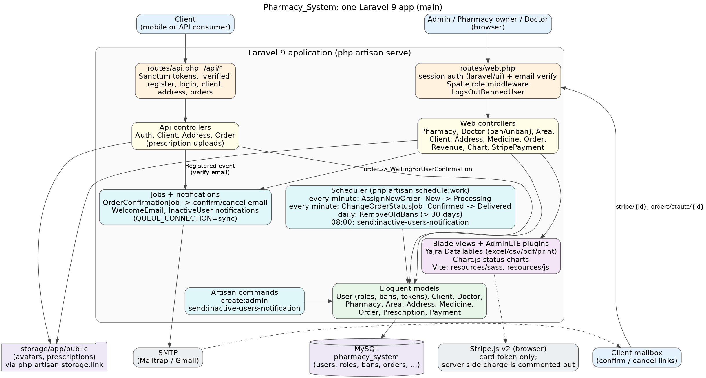

# PHARMACY MANAGEMENT SYSTEM

  

## INTRODUCTION
The Pharmacy Managment System is a Laravel web Application that used Most of Laravel Technologies for Pharmacies and Medical prescription purposes. 
The pharmacy Managment System Consists of Four Main Roles Like `admin`, `pharmacy`, `doctor` and `client`. 
The `admin` has a Full Access to the whole Parts of the system. The `pharmacy owner` has access on his Doctors and Orders. The `doctor` has access the orders. 
The `client` is the end user who can make any Order. 

## FEATURES
- Authuntication
- Email Verification
- Roles and Perimissions
- Auto Assign New Orders to the Highest-Priority Pharmacy in the Delivery Area
- Ban and UnBan Doctor
- Total Revenue of each Pharmacy 
- Email Notification
- Chart Statistics
- Stripe Payment
- Display Orders as Excel Sheet

## ARCHITECTURE
How the web dashboard, client API, scheduler, jobs and database fit together, with the order lifecycle: [docs/architecture.md](docs/architecture.md).

## DEMO
🎬
We Hope That You are enjoying Watching Our Demo Video 
[Click Here](https://www.youtube.com/watch?v=6k82NfqhROo) 

## INSTALLATION
Requires PHP 8.0-8.2 (the locked dependencies in `composer.lock` do not install on PHP 8.3), Composer, Node.js with npm, and MySQL.
<pre>
- git clone https://github.com/COG-GTM/Pharmacy_System.git && cd Pharmacy_System
- composer install
- npm install
- cp .env.example .env            # then set DB_*, MAIL_* and STRIPE_KEY
- php artisan key:generate
- create the MySQL database named in DB_DATABASE (default: pharmacy_system)
- php artisan migrate
- php artisan db:seed             # roles, countries and a default admin (database/seeders/AdminSeeder.php)
- php artisan storage:link
- npm run build                   # or keep `npm run dev` running instead while developing
- php artisan serve
- php artisan schedule:work       # in another terminal: assigns new orders, delivers confirmed orders, lifts old bans
</pre>

> **Known issue:** on `main`, `php artisan migrate` fails on an empty MySQL database. Migrations are ordered so `create_clients_table` (2014) adds foreign keys to `areas` and `users` before those tables exist, and `create_payments_table` references `orders` before it is created.

 ## CREATE ADMIN 
<pre>
php artisan create:admin --name="admin" --email=admin@admin.com --password=******
</pre>

## CLIENT APIs
`register`, `login` and `email/resend` are public. All other endpoints need the Sanctum token from `login` (`Authorization: Bearer <token>`) and a verified email.

    
|  METHODS      |         URI              | ACTIONS | 
| :---:         |         :---:            | :---: |   
| POST          | `/api/register`          | `Register` |
| POST          | `/api/login`             | `Login`  | 
| GET           | `/api/client/{id}`       | `Get Client By ID` | 
| PUT           | `/api/client/{id}`       | `Update Client` | 
| POST          | `/api/address`           | `Add New Address` | 
| GET           | `/api/address`           | `Get All Addresses` | 
| GET           | `/api/address/{id}`      | `Get Address By ID` | 
| PUT           | `/api/address/{id}`      | `Update Address` | 
| DELETE        | `/api/address/{id}`      | `Delete Address` | 
| POST          | `/api/orders`            | `Create New Order` | 
| GET           | `/api/orders`            | `Get My Orders` | 
| GET           | `/api/orders/{id}`       | `Get Order By ID` | 
| PUT           | `/api/orders/{id}`       | `Update Order` | 
| GET           | `/api/email/resend/{id}` | `Resend Email Verification` | 
    

    
   
## PACKAGES
<pre>
- laravel/sanctum                         v3.2.1                Laravel Sanctum provides a featherweight authentication
- laravel/ui                              v4.2.1                Laravel UI utilities and presets
- yajra/laravel-datatables                v9.0.0                Laravel DataTables Complete Package
- spatie/laravel-permission               5.10.0                Permission handling for Laravel 6.0 and up
- webpatser/laravel-countries             dev-master 9d0cd97    Laravel Countries is a bundle for Laravel, providing Al   
- egulias/email-validator                 3.2.5                 A library for validating emails against several RFCs
- cybercog/laravel-ban                    4.8.0                 Laravel Ban simplify blocking and banning Eloquent models  
- stripe/stripe-php                       v10.12.1              Stripe PHP Library
</pre>

## TECHNOLOGIES
- Laravel Framework
- MYSQL
- jQuery
- JavaSript
- Bootstrap
- HTML
- CSS
- SASS

## SUPPORT
If you like our work, feel free to  
⭐ this repository. It helps.

## AUTHORS
  - [Hager Abd El Galil](https://github.com/Hager-Abd-El-Galil)
  - [Mariam Reda Mokhtar](https://github.com/Mariam-Mokhtar)
  - [Radwa Hassan](https://github.com/RadwaHassan99)
  - [Rowan Tamer](https://github.com/rowantamer)
  - [Omnia Goher](https://github.com/Omnia-Goher)

    
    
    
    
    
    
    
    

  

