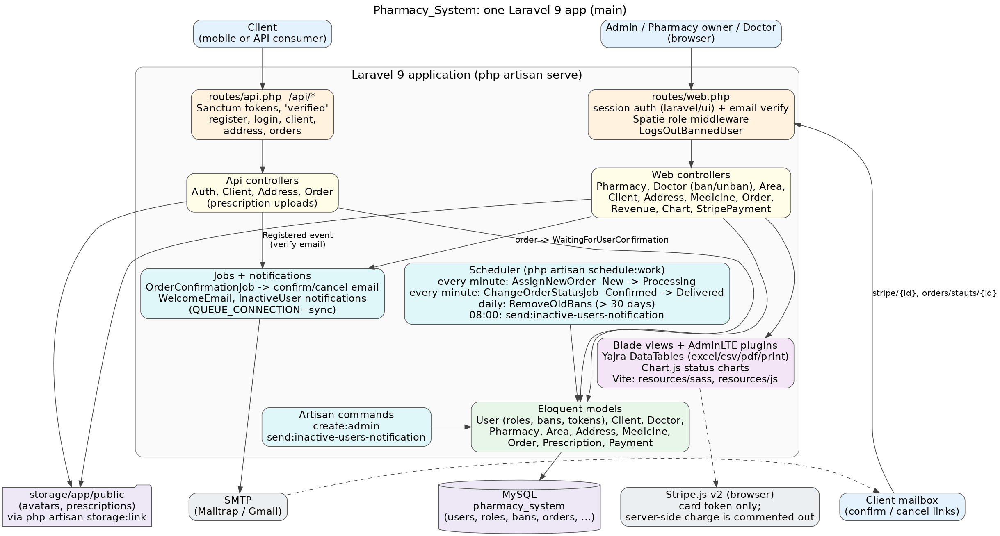

# Architecture

This page describes what the code on `main` does today. Pharmacy_System is one Laravel 9 application (PHP, MySQL, Blade + Vite) with two entry points: a session-based web dashboard for admins, pharmacy owners and doctors, and a Sanctum token REST API for clients.

The diagram source is [`diagrams/architecture.dot`](diagrams/architecture.dot) (Graphviz). Re-render the PNG and SVG with `docs/diagrams/render.sh` after editing it. The table-level ERD generated by `beyondcode/laravel-er-diagram-generator` is [`../erd.png`](../erd.png).

## Components

| Part | Where | What it does |
| --- | --- | --- |
| Web routes | `routes/web.php` | `Auth::routes(['verify' => true])` (laravel/ui) plus role-gated groups using Spatie's `role` middleware and `logs-out-banned-user` (cybercog/laravel-ban). |
| API routes | `routes/api.php` (prefix `/api`) | `register`, `login`, `email/resend/{id}` are public; everything else needs `auth:sanctum` and `verified`. |
| Web controllers | `app/Http/Controllers` | CRUD for pharmacies, doctors (with ban/unban), areas, clients, addresses, medicines and orders; revenue and chart data; the Stripe page. |
| API controllers | `app/Http/Controllers/Api` | Client registration and token login, client profile, client addresses, client orders with prescription image uploads. |
| Data grids | `app/DataTables` | Yajra DataTables (server-side) with excel / csv / pdf / print buttons; the orders grid is scoped to the signed-in pharmacy or doctor's pharmacy. |
| Views | `resources/views`, `public/plugins` | Blade templates on AdminLTE plugins, Chart.js status charts, assets built by Vite from `resources/sass/app.scss` and `resources/js/app.js`. |
| Models | `app/Models` | `User` (roles, bans, Sanctum tokens, email verification) with one `Client`, `Doctor` or `Pharmacy` profile; `Area`, `Address`, `Medicine`, `Order` (+ `orders_medicines` pivot), `Prescription`, `Payment`. |
| Jobs and notifications | `app/Jobs`, `app/Notifications`, `app/Mail` | Order confirmation email (with Confirm / Cancel links), welcome email, inactive-user email. `QUEUE_CONNECTION=sync`, so jobs run inline. |
| Scheduler | `app/Console/Kernel.php` | See [Scheduled work](#scheduled-work). Needs `php artisan schedule:work` (or cron running `schedule:run`). |
| Commands | `app/Console/Commands` | `create:admin`, `send:inactive-users-notification`. |
| Storage | `storage/app/public` | Avatars (`clients_Images`, `doctors_Images`, `pharmacies_Images`) and prescriptions (`images/prescriptions`), served through `php artisan storage:link`. |

## Roles

`database/seeders/RoleSeeder.php` creates four Spatie roles. What each can reach in `routes/web.php`:

| Role | Web access |
| --- | --- |
| `admin` | Everything: areas, clients, addresses, medicine edit/delete, pharmacy delete/restore, plus all below. |
| `pharmacy` | Pharmacies, doctors (create, delete, ban/unban), revenue, plus all below. |
| `doctor` | Dashboard and charts, medicines (list/show/create), orders, doctors (list/show/edit). |
| `client` | Only the Stripe confirm page on the web; everything else through `/api`. |

## Order lifecycle

Statuses come from the `orders.status` enum: `New`, `Processing`, `WaitingForUserConfirmation`, `Canceled`, `Confirmed`, `Delivered`.

1. A client creates an order with `POST /api/orders` (a delivery address they own and at least one prescription image). It starts as `New` with no pharmacy. Staff can also create orders from the dashboard (`OrderController::store`) with a chosen pharmacy and status.
2. Every minute `AssignNewOrder` picks, for each `New` order, the highest-`priority` pharmacy in the delivery address's area, and sets the order to `Processing`.
3. Staff edit the order (medicines, quantities, doctor). `OrderController::update` always sets `WaitingForUserConfirmation`, recomputes the price from the medicines, and emails the client through `OrderConfirmationJob` (`resources/views/mails/ConfirmOrder.blade.php`).
4. The email links to `stripe/{id}` (Confirm Order) and `orders/stauts/{id}` (Cancel Order). Both are web routes behind `auth`. Confirm shows a Stripe.js card form; submitting it sets `Confirmed`. Cancel sets `Canceled`, but its route sits in the `admin|pharmacy|doctor` group.
5. Every minute `ChangeOrderStatusJob` moves `Confirmed` orders to `Delivered`. The revenue page sums only `Delivered` orders.

No money moves: the server-side `Stripe\Charge::create` call in `StripePaymentController::stripePost` is commented out, so the card token from Stripe.js is ignored.

## Scheduled work

| Schedule | Task | Effect |
| --- | --- | --- |
| Every minute | `AssignNewOrder` | `New` orders get a pharmacy in their area and become `Processing`. |
| Every minute | `ChangeOrderStatusJob` | `Confirmed` orders become `Delivered`. |
| Daily | `RemoveOldBans` | Bans older than 30 days are lifted and deleted. |
| Daily 08:00 | `send:inactive-users-notification` | Emails users whose `last_login` is over a month old. |

## External services

| Service | Config | Used for |
| --- | --- | --- |
| MySQL | `DB_*` in `.env` | The only database (`phpunit.xml` has the SQLite override commented out). |
| SMTP (Mailtrap or Gmail) | `MAIL_*` | Email verification, order confirmation, welcome and inactive-user emails. |
| Stripe.js v2 | `STRIPE_KEY` (read in `resources/views/stripe.blade.php`) | Card tokenisation in the browser only; see the lifecycle note above. |

Pusher, Redis and AWS keys in `.env.example` are Laravel defaults; nothing on `main` uses them (`BROADCAST_DRIVER=log`, the Echo setup in `resources/js/bootstrap.js` is commented out).
